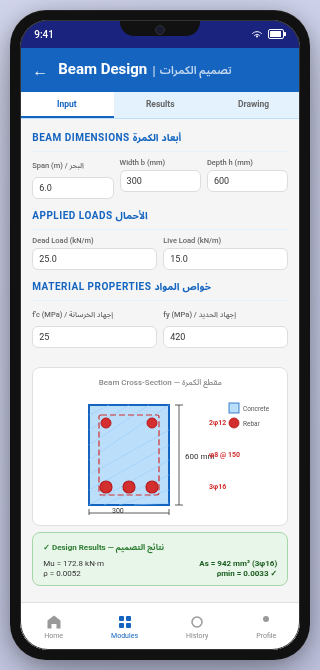
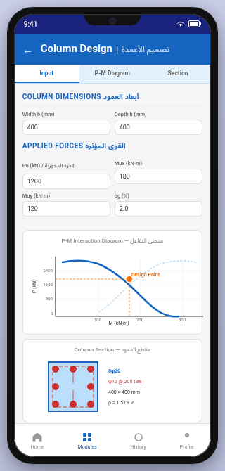
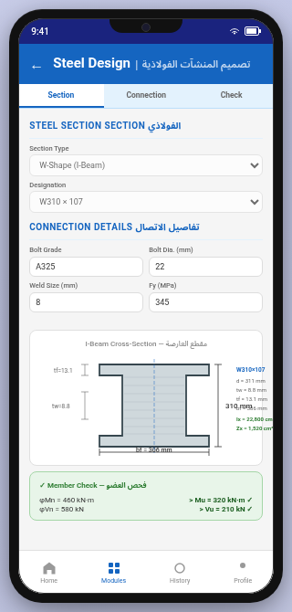
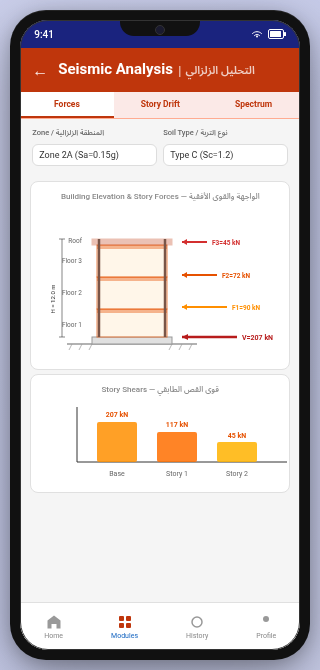
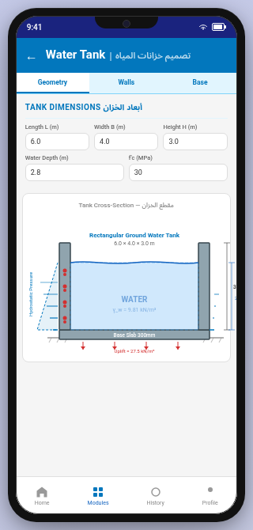

<div align="center">


# 🏗️ Civil Engineer Pro — المهندس المدني برو

### Your Complete Structural Engineering Companion | رفيقك الشامل في التصميم الإنشائي

<br/>

[](https://github.com/engahmed121314/civileg/actions/workflows/android.yml)
[](https://developer.android.com/about/versions)
[](https://kotlinlang.org)
[](https://developer.android.com/jetpack/compose)
[](LICENSE)
[](CONTRIBUTING.md)
[](SECURITY.md)

<br/>

**[English](#-english) | [العربية](#-العربية)**

</div>

---

## 📸 Screenshots | لقطات الشاشة

<div align="center">

| Home Screen | Beam Design | Column Design |
|:-----------:|:-----------:|:-------------:|
|  |  |  |

| Steel Design | Frame Analysis | Seismic Analysis |
|:------------:|:--------------:|:----------------:|
|  |  |  |

| Water Tank | Settings | Full Showcase |
|:----------:|:--------:|:-------------:|
|  |  |  |

</div>

---

# 🌐 English

## Overview

**Civil Engineer Pro** is a comprehensive Android application for structural engineers, civil engineering students, and construction professionals. It provides precise structural design and analysis tools for **reinforced concrete**, **steel structures**, **seismic analysis**, and **quantity surveying** — fully compliant with major international design codes.

The app supports **3 international design codes**: the **Egyptian Code (ECP 203/201/205)**, the **American Concrete Institute (ACI 318 / ASCE 7-16 / AISC 360-16)**, and the **Saudi Building Code (SBC 304/301/306)**.

> **Disclaimer:** This application is for *educational and preliminary design purposes only*. All results must be verified by a licensed structural engineer. The developer is not responsible for any errors or damages.

---

## ✨ Key Features

### 🧱 Reinforced Concrete Design

| Module | Description |
|--------|-------------|
| **Beam Design** | Simply supported, fixed, cantilever & roller-hinged beams — moment/shear diagrams, deflection checks, full reinforcement calculations |
| **Column Design** | Short & slender columns — effective length (K), axial + uniaxial/biaxial bending (Bresler + load contour), P-M interaction diagrams, 6 cross-sections |
| **Slab Design** | One-way & two-way: solid, ribbed, waffle, flat plate, flat slab, post-tensioned, precast — ACI Direct Design Method + deflection |
| **Footing Design** | Isolated, combined, strip, raft, pile cap — SBC bearing pressure with eccentricity, punching shear, one-way shear, reinforcement detailing |
| **Retaining Wall** | Cantilever walls — Rankine earth pressure, surcharge, water table, sliding/overturning/bearing safety checks, stem/toe/heel reinforcement |
| **Staircase Design** | Straight & dog-leg stairs — waist slab on slope, comfort formula (2R+G), main+distribution reinforcement, shear stirrups, deflection |
| **Water Tank Design** | Rectangular & circular (ground/elevated/underground) — hydrostatic analysis, hoop tension, crack-width checks, uplift, water-retaining minimums |

### 🔩 Steel Structure Design

| Module | Description |
|--------|-------------|
| **Steel Members** | AISC 360-16 LRFD — tension, compression (buckling), bending (LTB), combined loads (H1-1a/H1-1b) — ECP 205 / AISC / SBC 306 |
| **Base Plate Design** | Concentric & eccentric loads, pocket bases, anchor bolt design (grades 4.6–10.9) |
| **Bolt & Weld** | Bolt capacity (shear/bearing/tension/combined/slip-critical/block shear) + fillet weld (E60XX–E90XX) |
| **Steel Warehouse** | Complete portal frame — 4-view drawings (front/plan/side/3D isometric), BMD, PDF report |

### 🌍 Seismic Analysis

- **Equivalent Static Method** — base shear per ECP 201, ASCE 7-16, SBC 301
- **Design Response Spectrum** — spectral acceleration curves with design period marker

### 📐 2D Frame Analysis

- Full stiffness matrix solver — pin/roller/fixed nodes, UDL/point/moment/varying loads
- Bending moment, shear force & axial force diagrams
- Interactive canvas with pinch-to-zoom (0.5×–5×) and tap-to-inspect

### 🛠️ Additional Tools

| Tool | Description |
|------|-------------|
| **Bill of Quantities (BOQ)** | Auto quantity takeoff (concrete/steel/formwork/excavation) — 40+ material prices, 8 currencies |
| **Scientific Calculator** | Engineering calculator with trig & logarithmic functions |
| **Unit Converter** | Length, area, volume, weight, force, pressure/stress, moment |
| **Rebar Inventory** | 15 diameters × 5 grades — weight/cost + cutting optimization |
| **PDF Export** | Professional reports with Arabic text support + engineering drawings |
| **CSV Export** | Spreadsheet-compatible data export |
| **Design Archive** | Save & organize past projects with results and safety status |

---

## 📋 Supported Design Codes

| Code | Standards | Country |
|------|-----------|---------|
| **ECP** | ECP 203 (Concrete), ECP 201 (Seismic), ECP 205 (Steel) | 🇪🇬 Egypt |
| **ACI / AISC** | ACI 318-19, ASCE 7-16, AISC 360-16 | 🇺🇸 USA / International |
| **SBC** | SBC 304 (Concrete), SBC 301 (Seismic), SBC 306 (Steel) | 🇸🇦 Saudi Arabia |

---

## 🏛️ Technical Architecture

| Component | Technology |
|-----------|------------|
| **Language** | Kotlin 2.1.0 |
| **UI Framework** | Jetpack Compose + Material 3 |
| **Dependency Injection** | Hilt (Dagger) |
| **Database** | Room (SQLite) — 11 entities, 11 DAOs |
| **Navigation** | Jetpack Navigation Compose |
| **Build System** | Gradle 8.13 + Version Catalog |
| **Min SDK** | API 26 (Android 8.0 Oreo) |
| **Target SDK** | API 36 (Android 16) |
| **JDK** | 17 (Temurin) |
| **Architecture** | MVVM + Strategy Pattern (`CalculationFactory`) |

### Project Structure

```
app/src/main/java/com/civileg/app/
├── di/                    # Hilt dependency injection modules
├── db/                    # Room database, DAOs (11), entities (11)
├── domain/
│   ├── calculations/
│   │   ├── aci/           # ACI 318 / AISC / ASCE implementations
│   │   ├── ecp/           # ECP 203/201/205 implementations
│   │   ├── sbc/           # SBC 304/301/306 implementations
│   │   ├── base/          # Abstract base design classes
│   │   └── utils/         # P-M interaction diagrams, utilities
│   ├── entities/          # Domain data classes
│   ├── validators/        # Input validation logic
│   └── usecases/          # Business logic use cases
├── ui/compose/
│   ├── components/
│   │   ├── drawings/      # Professional engineering drawings (Canvas)
│   │   ├── charts/        # Analysis charts & diagrams
│   │   └── interactive/   # Interactive section views
│   └── screens/           # 22 design & tool screens
├── viewmodel/             # 16 MVVM ViewModels
├── utils/                 # PDF/CSV export, steel tables, converters
└── pricing/               # Material pricing & cost management
```

### Project Statistics

- 📁 **260+ Kotlin source files**
- 📝 **80,000+ lines of code**
- 🖥️ **22 design & tool screens**
- 📐 **3 international design codes**
- 🏗️ **7 RC + 4 Steel + 2 Seismic + 5 tool modules**

---

## 🔒 Security & Protection

| Measure | Details |
|---------|---------|
| **Play Integrity API** | Tamper detection & genuine device verification |
| **AES-256 Encryption** | Sensitive local data encrypted at rest |
| **R8 / ProGuard** | Advanced obfuscation protecting design formulas |
| **No Cloud Dependency** | All calculations run 100% offline on-device |
| **No Data Collection** | Zero user data transmitted or stored externally |
| **Secure In-App Billing** | Google Play Billing with server-side verification |

> Found a security issue? Please report it privately at **engahmed121314@gmail.com** — see [SECURITY.md](SECURITY.md).

---

## 🚀 Getting Started

### Prerequisites

- **JDK 17** (Temurin recommended)
- **Android Studio Meerkat** or newer
- **Android SDK** with API 36
- **Gradle 8.13** (handled automatically by the wrapper)

### Build Instructions

```bash
# 1. Clone the repository
git clone https://github.com/engahmed121314/civileg.git
cd civileg

# 2. Build debug APK
./gradlew assembleDebug

# 3. Install on connected device / emulator
./gradlew installDebug

# 4. Run unit tests
./gradlew testDebugUnitTest

# 5. Build release AAB (requires signing config)
./gradlew bundleRelease

# 6. Clean build
./gradlew clean assembleDebug
```

**Output:** `app/build/outputs/apk/debug/app-debug.apk`

### Emulator Workflow (Windows)

```powershell
# Full workflow: boot → build → install → screenshots → tests
powershell -File tools\emulator\Test-App.ps1

# Individual steps
powershell -File tools\emulator\Start-Emulator.ps1
powershell -File tools\emulator\Build-App.ps1
powershell -File tools\emulator\Install-App.ps1 -Launch
powershell -File tools\emulator\Run-Tests.ps1
powershell -File tools\emulator\Stop-Emulator.ps1
```

> AVD: `civileg2_api36` (Android 16 / API 36, Pixel 6) — see [`tools/emulator/README.md`](tools/emulator/README.md)

---

## 🤝 Contributing

Contributions are welcome! Please follow these steps:

1. **Fork** the repository
2. Create a feature branch: `git checkout -b feature/your-feature`
3. Commit your changes: `git commit -m 'feat: add amazing feature'`
4. Push to the branch: `git push origin feature/your-feature`
5. Open a **Pull Request** using the [PR template](.github/PULL_REQUEST_TEMPLATE.md)

### Reporting Issues

- 🐛 **Bug reports** → [Bug Report Template](.github/ISSUE_TEMPLATE/bug_report.md)
- 💡 **Feature requests** → [Feature Request Template](.github/ISSUE_TEMPLATE/feature_request.md)

### Code Guidelines

- Follow the existing MVVM + Strategy pattern architecture
- All UI strings must be **bilingual** (Arabic + English in `strings.xml`)
- New calculation modules must be tested against hand calculations
- ProGuard rules must be updated for any new public API

---

## 📦 CI/CD Pipeline

The project uses **GitHub Actions** for continuous integration:

| Job | Trigger | Description |
|-----|---------|-------------|
| **Lint** | Push / PR | Android Lint analysis |
| **Unit Tests** | After Lint | JVM unit tests (`testDebugUnitTest`) |
| **Debug Build** | After Tests | Build & upload debug APK artifact |
| **Release AAB** | On `v*` tag | Sign & upload release bundle |
| **Dependabot** | Weekly | Gradle dependency updates |

---

## 📄 License

This project is licensed under the **MIT License** — see the [LICENSE](LICENSE) file for details.

```
Copyright (c) 2024 Ahmed (engahmed121314)
```

---

## 📞 Contact & Support

| Channel | Details |
|---------|---------|
| 👤 **Developer** | Eng. Ahmed Magdy |
| 📧 **Email** | [engahmed121314@gmail.com](mailto:engahmed121314@gmail.com) |
| 📱 **Phone** | +20 101 262 8353 |
| 🐛 **Issues** | [GitHub Issues](https://github.com/engahmed121314/civileg/issues) |
| 🔒 **Security** | [Security Policy](SECURITY.md) |

---
---

# 🌐 العربية

<div align="right">

## نظرة عامة

**المهندس المدني برو** هو تطبيق أندرويد شامل مصمم للمهندسين الإنشائيين وطلاب الهندسة المدنية ومحترفي البناء. يوفر أدوات تصميم وتحليل دقيقة للـ**خرسانة المسلحة** و**المنشآت الفولاذية** و**التحليل الزلزالي** و**جداول الكميات** — متوافق تماماً مع كودات التصميم الدولية الرئيسية.

يدعم التطبيق **3 كودات تصميم دولية**: **الكود المصري (ECP 203/201/205)**، **الكود الأمريكي (ACI 318 / ASCE 7-16 / AISC 360-16)**، و**الكود السعودي (SBC 304/301/306)**.

> **إخلاء المسؤولية:** هذا التطبيق لأغراض *تعليمية والتصميم المبدئي فقط*. يجب التحقق من جميع النتائج بواسطة مهندس إنشائي مرخص.

---

## ✨ الميزات الرئيسية

### 🧱 تصميم الخرسانة المسلحة

| الوحدة | الوصف |
|--------|-------|
| **تصميم الكمرات** | بسيطة ومثبتة وشاربية وقلابة — مخططات العزوم والقص، فحص الانحناء، حسابات التسليح الكاملة |
| **تصميم الأعمدة** | قصيرة ونحيفة — معامل الطول الفعّال (K)، انحناء أحادي وثنائي المحور (Bresler)، مخططات P-M، 6 أشكال مقطعية |
| **تصميم البلاطات** | صلبة ومرقيقة ووافل ومسطحة وما بعد الشد ومسبقة الصب — طريقة ACI المباشرة + فحص الانحناء |
| **تصميم الأساسات** | منفصلة ومركبة وشارية ولبشة وقبعات خازوق — ضغط التربة، قص الثقب، قص أحادي، تفاصيل التسليح |
| **حوائط السند** | حوائط قنطرية — ضغط رانكين، رصف، منسوب المياه، فحص الانزلاق/الانقلاب/الضغط |
| **تصميم السلالم** | مستقيمة ورجل كلب — لوح السلم على الميل، معادلة الراحة (2R+G)، تسليح رئيسي وتوزيعي |
| **تصميم الخزانات** | مستطيلة ودائرية (أرضية/مرتفعة/تحت أرض) — ضغط هيدروستاتيكي، قوى إحاطة، فحوص الشروخ، الطفو |

### 🔩 تصميم المنشآت الفولاذية

| الوحدة | الوصف |
|--------|-------|
| **الأعضاء الفولاذية** | AISC 360-16 LRFD — شد وضغط (انبعاج) وانحناء (LTB) وأحمال مركبة (H1-1a/H1-1b) |
| **لوحات القاعدة** | محملة مركزياً ولامركزياً، قواعد جيبية، براغي التثبيت |
| **البراغي واللحامات** | سعة البراغي والانزلاق الحرج وقص الكتلة + اللحامات التفصيلية |
| **المستودعات الفولاذية** | تصميم كامل لإطارات البوابة — رسومات 4 مناظر (أمامي/مسقط/جانبي/ثلاثي)، تقرير PDF |

### 🌍 التحليل الزلزالي

- **طريقة القوى الثابتة المكافئة** — قوة القص القاعدي حسب ECP 201 و ASCE 7-16 و SBC 301
- **منحنى طيف التصميم** — منحنيات التسارع الطيفي مع علامة الدورة الزمنية

### 📐 تحليل الإطارات ثنائية الأبعاد

- محلل مصفوفة الصلابة — عقد مفصلية/بكرة/ثابتة، أحمال UDL/مركزة/عزم/متغيرة خطياً
- مخططات العزم والقص والقوة المحورية
- لوحة رسم تفاعلية مع تقريب بالضغط (0.5×–5×) والنقر للفحص

### 🛠️ أدوات إضافية

| الأداة | الوصف |
|--------|-------|
| **جداول الكميات** | جرد تلقائي (خرسانة/حديد/قالب/حفر) — 40+ سعر مادة، 8 عملات |
| **الآلة الحاسبة العلمية** | دوال المثلثات واللوغاريتمات |
| **محول الوحدات** | طول وسطح وحجم ووزن وقوة وإجهاد وعزم |
| **جرد التسليح** | 15 قطر × 5 درجات — وزن/تكلفة + خطط القص المثلى |
| **تصدير PDF** | تقارير احترافية مع دعم كامل للنص العربي |
| **تصدير CSV** | تصدير البيانات بتنسيق جداول البيانات |
| **أرشيف التصاميم** | حفظ وتنظيم المشاريع السابقة مع النتائج وحالة السلامة |

---

## 📋 كودات التصميم المدعومة

| الكود | المعايير | الدولة |
|-------|---------|--------|
| **ECP** | ECP 203 (خرسانة)، ECP 201 (زلازل)، ECP 205 (فولاذ) | 🇪🇬 مصر |
| **ACI / AISC** | ACI 318-19، ASCE 7-16، AISC 360-16 | 🇺🇸 أمريكا / دولي |
| **SBC** | SBC 304 (خرسانة)، SBC 301 (زلازل)، SBC 306 (فولاذ) | 🇸🇦 السعودية |

---

## 🏛️ البنية التقنية

| المكوّن | التقنية |
|---------|---------|
| **اللغة** | Kotlin 2.1.0 |
| **إطار واجهة المستخدم** | Jetpack Compose + Material 3 |
| **حقن التبعيات** | Hilt (Dagger) |
| **قاعدة البيانات** | Room (SQLite) — 11 كيان، 11 واجهة DAO |
| **التنقل** | Jetpack Navigation Compose |
| **نظام البناء** | Gradle 8.13 + Version Catalog |
| **الحد الأدنى للمصدر** | API 26 (Android 8.0 Oreo) |
| **المصدر المستهدف** | API 36 (Android 16) |
| **JDK** | 17 (Temurin) |
| **المعمارية** | MVVM + نمط الاستراتيجية (`CalculationFactory`) |

### إحصائيات المشروع

- 📁 **أكثر من 260 ملف Kotlin**
- 📝 **أكثر من 80,000 سطر برمجي**
- 🖥️ **22 شاشة تصميم وأدوات**
- 📐 **3 كودات تصميم دولية**
- 🏗️ **7 وحدات خرسانة + 4 فولاذ + 2 زلازل + 5 أدوات**

---

## 🔒 الأمان والحماية

| الإجراء | التفاصيل |
|---------|---------|
| **Play Integrity API** | كشف التلاعب والتحقق من الأجهزة الأصيلة |
| **تشفير AES-256** | تشفير البيانات الحساسة المحلية |
| **R8 / ProGuard** | تشفير متقدم لحماية خوارزميات التصميم والمعادلات الهندسية |
| **بدون اتصال بالإنترنت** | جميع الحسابات تعمل 100% محلياً على الجهاز |
| **لا جمع بيانات** | لا يتم نقل أو تخزين بيانات المستخدم خارجياً |
| **فوترة آمنة** | Google Play Billing مع التحقق من جانب الخادم |

> اكتشفت ثغرة أمنية؟ يرجى الإبلاغ عنها بسرية على **engahmed121314@gmail.com** — راجع [SECURITY.md](SECURITY.md).

---

## 🚀 البدء السريع

### المتطلبات المسبقة

- **JDK 17** (يُنصح بـ Temurin)
- **Android Studio Meerkat** أو أحدث
- **Android SDK** مع API 36
- **Gradle 8.13** (يتم التعامل معه تلقائياً عبر Gradle Wrapper)

### أوامر البناء

```bash
# 1. استنساخ المستودع
git clone https://github.com/engahmed121314/civileg.git
cd civileg

# 2. بناء APK التطوير
./gradlew assembleDebug

# 3. تثبيت على الجهاز/المحاكي
./gradlew installDebug

# 4. تشغيل الاختبارات
./gradlew testDebugUnitTest

# 5. بناء AAB للإصدار (يتطلب إعداد التوقيع)
./gradlew bundleRelease

# 6. بناء نظيف
./gradlew clean assembleDebug
```

**المخرج:** `app/build/outputs/apk/debug/app-debug.apk`

### سير عمل المحاكي (Windows)

```powershell
# سير عمل كامل: تشغيل → بناء → تثبيت → لقطات → اختبارات
powershell -File tools\emulator\Test-App.ps1
```

---

## 🤝 المساهمة

المساهمات مرحب بها! اتبع الخطوات التالية:

1. **Fork** المستودع
2. أنشئ فرعاً: `git checkout -b feature/ميزتك`
3. ارفع تعديلاتك: `git commit -m 'feat: إضافة ميزة رائعة'`
4. ادفع الفرع: `git push origin feature/ميزتك`
5. افتح **Pull Request** باستخدام [قالب PR](.github/PULL_REQUEST_TEMPLATE.md)

### الإبلاغ عن المشاكل

- 🐛 **الأخطاء** → [نموذج تقرير الخطأ](.github/ISSUE_TEMPLATE/bug_report.md)
- 💡 **طلبات الميزات** → [نموذج طلب الميزة](.github/ISSUE_TEMPLATE/feature_request.md)

---

## 📦 خط أنابيب CI/CD

| المهمة | المُشغِّل | الوصف |
|--------|---------|-------|
| **Lint** | Push / PR | تحليل Android Lint |
| **اختبارات الوحدة** | بعد Lint | اختبارات JVM |
| **بناء Debug** | بعد الاختبارات | بناء ورفع APK |
| **إصدار AAB** | عند وسم `v*` | توقيع ورفع حزمة الإصدار |
| **Dependabot** | أسبوعياً | تحديثات تبعيات Gradle |

---

## 📄 الرخصة

هذا المشروع مرخص تحت **رخصة MIT** — راجع ملف [LICENSE](LICENSE) للتفاصيل.

```
حقوق النشر © 2024 Ahmed (engahmed121314)
```

---

## 📞 التواصل والدعم

| القناة | التفاصيل |
|--------|---------|
| 👤 **المطور** | المهندس أحمد مجدي |
| 📧 **البريد الإلكتروني** | [engahmed121314@gmail.com](mailto:engahmed121314@gmail.com) |
| 📱 **الهاتف** | 01012628353+ |
| 🐛 **المشاكل** | [GitHub Issues](https://github.com/engahmed121314/civileg/issues) |
| 🔒 **الأمان** | [سياسة الأمان](SECURITY.md) |

</div>

---

<div align="center">

**Made with ❤️ for Civil Engineers Worldwide**
**صُنع بشغف لمهندسي المدني حول العالم**

[](https://github.com/engahmed121314/civileg/stargazers)
[](https://github.com/engahmed121314/civileg/network/members)
[](https://github.com/engahmed121314/civileg/issues)

</div>
