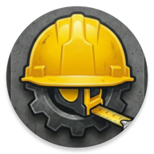
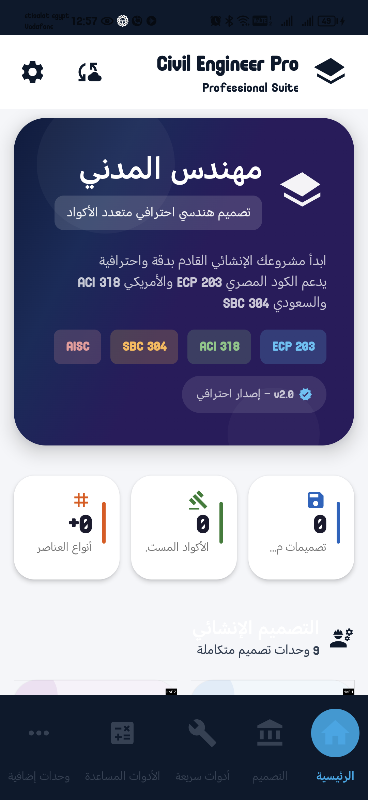
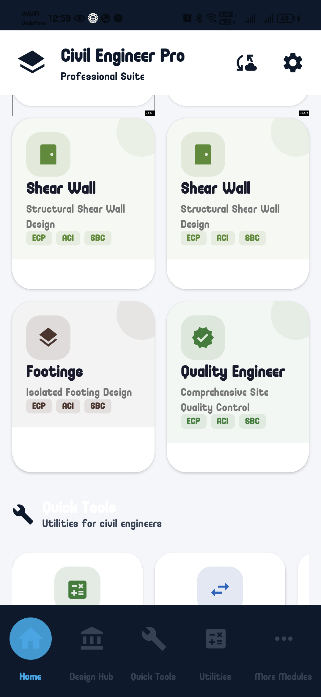
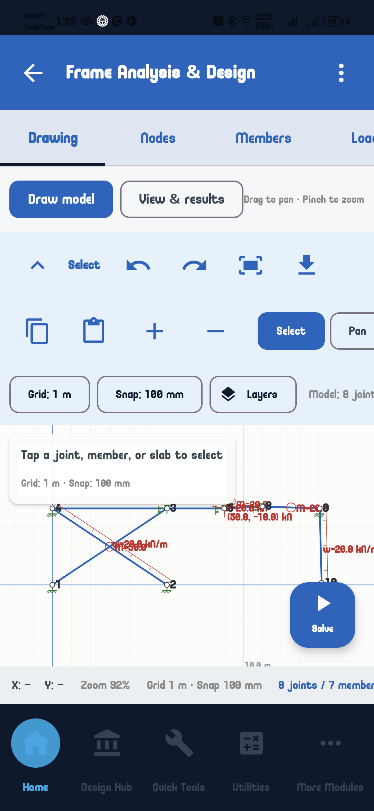
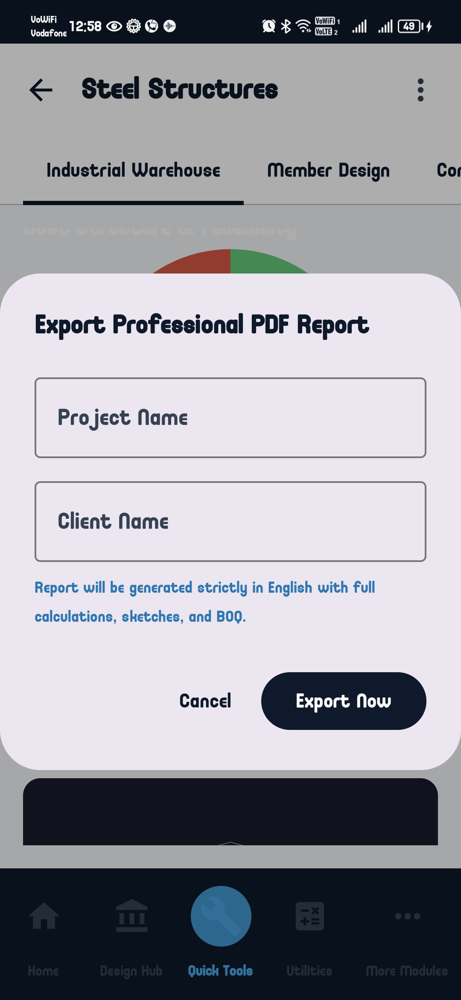
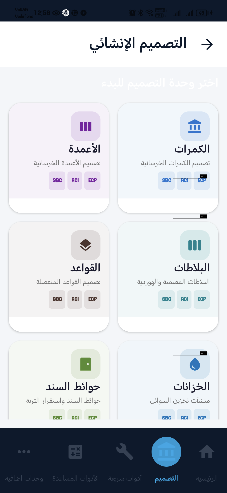
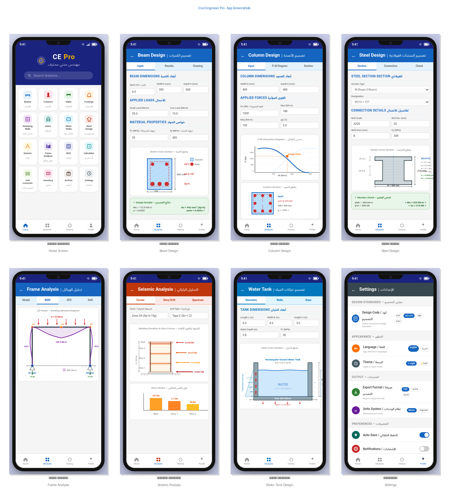

<div align="center">



# 🏗️ Civil Engineer Pro — المهندس المدني برو

### Your Complete Structural Engineering Companion | رفيقك الشامل في التصميم الإنشائي

<br/>

[](https://github.com/engahmed121314/civileg2/actions/workflows/android.yml)
[](https://developer.android.com/about/versions)
[](https://kotlinlang.org)
[](https://developer.android.com/jetpack/compose)
[](LICENSE)
[](CONTRIBUTING.md)
[](SECURITY.md)
[](https://github.com/sponsors/engahmed121314)

<br/>

[-success?style=for-the-badge&logo=android&logoColor=white)](https://github.com/engahmed121314/civileg2/releases)
[](docs/MONETIZATION_GUIDE.md)

<br/>

**[English](#-english) | [العربية](#-العربية)**

</div>

---

## 📸 Screenshots | لقطات الشاشة

<div align="center">

| Home Screen — الرئيسية | Design Hub — مركز التصميم | Frame Analysis — تحليل الإطارات |
|:----------------------:|:-------------------------:|:-------------------------------:|
|  |  |  |

| PDF Export — تصدير التقارير | Settings & Codes — إعدادات الأكواد | Full Showcase — نظرة عامة |
|:---------------------------:|:----------------------------------:|:-------------------------:|
|  |  |  |

</div>

---

# 🌐 English

## Overview

**Civil Engineer Pro** is a bilingual Android toolkit for preliminary structural design and analysis, including **reinforced concrete**, **steel structures**, **seismic analysis**, **quantity surveying**, engineering drawings, and PDF reports. It offers selectable Egyptian, American, and Saudi code bases; code coverage and assumptions vary by calculation module.

The app provides selections for the **Egyptian Code (ECP)**, **American standards (ACI / ASCE / AISC)**, and the **Saudi Building Code (SBC)**. The selected edition shown by a module is not a certification that every provision of that edition has been implemented.

> **Disclaimer:** This application is for *educational and preliminary design purposes only*. Its calculations are not a substitute for the applicable standards, project specifications, or independent engineering review. A licensed structural engineer must verify inputs, assumptions, and results before use.

---

## 📥 Download Pre-built APK

Looking to run the app directly on your Android phone without building from source?
- 📦 **[Download Latest APK from GitHub Releases](https://github.com/engahmed121314/civileg2/releases)**
- Compatible with **Android 8.0 (Oreo / API 26) through Android 16 (API 36)**.
- Simply download `app-release.apk` (or `app-debug.apk`), enable *"Install Unknown Apps"* in settings, and open the app.

---

## ✨ Key Features

### 🧱 Reinforced Concrete Design

| Module | Description |
|--------|-------------|
| **Beam Design** | Simply supported, fixed, cantilever & roller-hinged beams — moment/shear diagrams, deflection checks, full reinforcement calculations |
| **Column Design** | Short & slender columns — effective length (K), axial + uniaxial/biaxial bending (Bresler + load contour), P-M interaction diagrams, 6 cross-sections |
| **Slab Design** | One-way & two-way: solid, ribbed, waffle, flat plate, flat slab, post-tensioned, precast — ACI Direct Design Method + deflection |
| **Footing Design** | Isolated, combined, strip, raft, pile cap — SBC bearing pressure with eccentricity, punching shear, one-way shear, reinforcement detailing |
| **Retaining Wall** | Cantilever walls — Rankine earth pressure, surcharge, water table, sliding/overturning/bearing safety checks, stem/toe/heel reinforcement |
| **Staircase Design** | Straight & dog-leg stairs — waist slab on slope, comfort formula (2R+G), main+distribution reinforcement, shear stirrups, deflection |
| **Water Tank Design** | Rectangular & circular (ground/elevated/underground) — hydrostatic analysis, hoop tension, crack-width checks, uplift, water-retaining minimums |

### 🔩 Steel Structure Design

| Module | Description |
|--------|-------------|
| **Steel Members** | Preliminary checks against the selected ECP 205, AISC 360-22, or SBC 306 basis; applicability and assumptions vary by module |
| **Base Plate Design** | Concentric & eccentric loads, pocket bases, anchor bolt design (grades 4.6–10.9) |
| **Bolt & Weld** | Bolt capacity (shear/bearing/tension/combined/slip-critical/block shear) + fillet weld (E60XX–E90XX) |
| **Steel Warehouse** | Complete portal frame — 4-view drawings (front/plan/side/3D isometric), BMD, PDF report |

### 🌍 Seismic Analysis

- **Equivalent Static Method** — base shear per ECP 201, ASCE 7-16, SBC 301
- **Design Response Spectrum** — spectral acceleration curves with design period marker

### 📐 2D Frame Analysis

- Full stiffness matrix solver — pin/roller/fixed nodes, UDL/point/moment/varying loads
- Bending moment, shear force & axial force diagrams
- Interactive canvas with pinch-to-zoom (0.5×–5×) and tap-to-inspect

### 🛠️ Additional Tools

| Tool | Description |
|------|-------------|
| **Bill of Quantities (BOQ)** | Auto quantity takeoff (concrete/steel/formwork/excavation) — 40+ material prices, 8 currencies |
| **Scientific Calculator** | Engineering calculator with trig & logarithmic functions |
| **Unit Converter** | Length, area, volume, weight, force, pressure/stress, moment |
| **Rebar Inventory** | 15 diameters × 5 grades — weight/cost + cutting optimization |
| **PDF Export** | Professional reports with Arabic text support + engineering drawings |
| **CSV Export** | Spreadsheet-compatible data export |
| **Design Archive** | Save & organize past projects with results and safety status |

---

## 📋 Supported Design Codes

| Code | Standards | Country |
|------|-----------|---------|
| **ECP** | ECP 203-2025 (concrete selection), ECP 201 (seismic), ECP 205-2007 (steel basis) | 🇪🇬 Egypt |
| **ACI / ASCE / AISC** | ACI 318-25 (concrete selection), ASCE 7-16 (seismic), AISC 360-22 (steel basis) | 🇺🇸 USA / International |
| **SBC** | SBC 304-2024 (concrete selection), SBC 301 (seismic), SBC 306-2018 (steel basis) | 🇸🇦 Saudi Arabia |

These are the editions identified by the app's current code selector and quality-control labels. Individual calculators may use different assumptions or legacy clause references; confirm the governing edition and provisions for each project.

---

## 🏛️ Technical Architecture

| Component | Technology |
|-----------|------------|
| **Language** | Kotlin 2.2.20 |
| **UI Framework** | Jetpack Compose + Material 3 |
| **Dependency Injection** | Hilt (Dagger) |
| **Database** | Room (SQLite) — 11 entities, 11 DAOs |
| **Navigation** | Jetpack Navigation Compose |
| **Build System** | Gradle 9.6.0 + Version Catalog |
| **Min SDK** | API 26 (Android 8.0 Oreo) |
| **Target SDK** | API 36 (Android 16) |
| **JDK** | 17 (Temurin) |
| **Architecture** | MVVM + Strategy Pattern (`CalculationFactory`) |

### Project Structure

```
app/src/main/java/com/civileg/app/
├── di/                    # Hilt dependency injection modules
├── db/                    # Room database, DAOs (11), entities (11)
├── domain/
│   ├── calculations/
│   │   ├── aci/           # ACI 318 / AISC / ASCE implementations
│   │   ├── ecp/           # ECP 203/201/205 implementations
│   │   ├── sbc/           # SBC 304/301/306 implementations
│   │   ├── base/          # Abstract base design classes
│   │   └── utils/         # P-M interaction diagrams, utilities
│   ├── entities/          # Domain data classes
│   ├── validators/        # Input validation logic
│   └── usecases/          # Business logic use cases
├── ui/compose/
│   ├── components/
│   │   ├── drawings/      # Professional engineering drawings (Canvas)
│   │   ├── charts/        # Analysis charts & diagrams
│   │   └── interactive/   # Interactive section views
│   └── screens/           # 22 design & tool screens
├── viewmodel/             # 16 MVVM ViewModels
├── utils/                 # PDF/CSV export, steel tables, converters
└── pricing/               # Material pricing & cost management
```

### Project Statistics

- 📁 **260+ Kotlin source files**
- 📝 **80,000+ lines of code**
- 🖥️ **22 design & tool screens**
- 📐 **3 international design codes**
- 🏗️ **7 RC + 4 Steel + 2 Seismic + 5 tool modules**

---

## 🔒 Security & Protection

| Measure | Details |
|---------|---------|
| **Play Integrity API** | Tamper detection & genuine device verification |
| **AES-256 Encryption** | Sensitive local data encrypted at rest |
| **R8 / ProGuard** | Advanced obfuscation protecting design formulas |
| **On-device calculations** | Core structural calculations run locally; network-dependent services may require connectivity |
| **Data disclosures** | Firebase Crashlytics is included as a dependency; review runtime collection and Google Play Data safety disclosures before release |
| **Sponsorship** | Optional project support through GitHub Sponsors; availability depends on the maintainer's account approval |

> Found a security issue? Please report it privately at **engahmed121314@gmail.com** — see [SECURITY.md](SECURITY.md).

---

## 💰 Monetization & Revenue Opportunities

Civil Engineer Pro is designed with production-ready monetization avenues:
- **Google AdMob Integration**: Non-intrusive Banner, Interstitial, Native, and Rewarded Ads with GDPR/UMP consent management.
- **In-App Subscriptions (Google Play Billing v7)**: Monthly and Yearly Pro plans (`civileg_premium_monthly`, `civileg_premium_yearly`) for ad-free experience and premium PDF reports.
- **GitHub Sponsors & Open Collective**: Community and developer support via `.github/FUNDING.yml`.
- **Enterprise & White-Label Licensing**: Custom versions tailored for engineering firms and contractors.
- 📖 Read the full **[Monetization & Revenue Guide](docs/MONETIZATION_GUIDE.md)** for detailed setup instructions.

---

## 🚀 Getting Started

### Prerequisites

- **JDK 17** (Temurin recommended)
- **Android Studio Meerkat** or newer
- **Android SDK** with API 36
- **Gradle 9.6.0** (handled automatically by the wrapper)

### Build Instructions

```bash
# 1. Clone the repository
git clone https://github.com/engahmed121314/civileg2.git
cd civileg2

# 2. Build debug APK
./gradlew assembleDebug

# 3. Install on connected device / emulator
./gradlew installDebug

# 4. Run unit tests
./gradlew testDebugUnitTest

# 5. Build release AAB (requires signing config)
./gradlew bundleRelease

# 6. Clean build
./gradlew clean assembleDebug
```

**Output:** `app/build/outputs/apk/debug/app-debug.apk`

### Emulator Workflow (Windows)

```powershell
# Full workflow: boot → build → install → screenshots → tests
powershell -File tools\emulator\Test-App.ps1

# Individual steps
powershell -File tools\emulator\Start-Emulator.ps1
powershell -File tools\emulator\Build-App.ps1
powershell -File tools\emulator\Install-App.ps1 -Launch
powershell -File tools\emulator\Run-Tests.ps1
powershell -File tools\emulator\Stop-Emulator.ps1
```

> AVD: `civileg2_api36` (Android 16 / API 36, Pixel 6) — see [`tools/emulator/README.md`](tools/emulator/README.md)

---

## 🤝 Contributing

Contributions are welcome! Please follow these steps:

1. **Fork** the repository
2. Create a feature branch: `git checkout -b feature/your-feature`
3. Commit your changes: `git commit -m 'feat: add amazing feature'`
4. Push to the branch: `git push origin feature/your-feature`
5. Open a **Pull Request** using the [PR template](.github/PULL_REQUEST_TEMPLATE.md)

### Reporting Issues

- 🐛 **Bug reports** → [Bug Report Template](.github/ISSUE_TEMPLATE/bug_report.md)
- 💡 **Feature requests** → [Feature Request Template](.github/ISSUE_TEMPLATE/feature_request.md)

### Code Guidelines

- Follow the existing MVVM + Strategy pattern architecture
- All UI strings must be **bilingual** (Arabic + English in `strings.xml`)
- New calculation modules must be tested against hand calculations
- ProGuard rules must be updated for any new public API

---

## 📦 CI/CD Pipeline

The project uses **GitHub Actions** for continuous integration:

| Job | Trigger | Description |
|-----|---------|-------------|
| **Android CI** | Push to `master`, pull requests to `master`, or manual dispatch | JVM unit tests, non-blocking lint report, and debug APK artifact; no emulator |
| **Release AAB** | Push a `v*` tag (or dispatch on that tag) | Signed release bundle artifact; requires `KEYSTORE_BASE64`, `KEY_ALIAS`, `KEY_PASSWORD`, and `KEYSTORE_PASSWORD` repository secrets |
| **Release APK** | Manual dispatch | Signed APK artifact; requires the same signing secrets |
| **Dependabot** | Weekly | Gradle dependency updates |

Release builds optionally use these GitHub repository variables: `ADMOB_APP_ID`,
`ADMOB_BANNER_ID`, `ADMOB_INTERSTITIAL_ID`, `ADMOB_NATIVE_ID`, and
`ADMOB_REWARDED_ID`. Configure all five together; if none are configured, the
build warns and retains Google's test ad IDs.

---

## 📄 License

This project is licensed under the **MIT License** — see the [LICENSE](LICENSE) file for details.

```
Copyright (c) 2024 Ahmed (engahmed121314)
```

---

## 📞 Contact & Support

| Channel | Details |
|---------|---------|
| 👤 **Developer** | Eng. Ahmed Magdy |
| 🌐 **GitHub** | [github.com/engahmed121314/civileg2](https://github.com/engahmed121314/civileg2) |
| 📧 **Email** | [engahmed121314@gmail.com](mailto:engahmed121314@gmail.com) |
| 📱 **Phone** | +20 101 262 8353 |
| 🐛 **Issues** | [GitHub Issues](https://github.com/engahmed121314/civileg2/issues) |
| 🔒 **Security** | [Security Policy](SECURITY.md) |
| 💚 **Sponsor** | [GitHub Sponsors](https://github.com/sponsors/engahmed121314) — available after the maintainer activates a Sponsors profile |

---
---

# 🌐 العربية

<div align="right">

## نظرة عامة

**المهندس المدني برو** مجموعة أدوات أندرويد ثنائية اللغة للتصميم والتحليل الإنشائي المبدئي، تشمل **الخرسانة المسلحة** و**المنشآت الفولاذية** و**التحليل الزلزالي** و**جداول الكميات** والرسومات الهندسية وتقارير PDF. تتيح اختيار أساس مصري أو أمريكي أو سعودي، مع اختلاف نطاق التطبيق والافتراضات بين وحدات الحساب.

يوفر التطبيق اختيارات **الكود المصري (ECP)** و**المعايير الأمريكية (ACI / ASCE / AISC)** و**الكود السعودي (SBC)**. ظهور إصدار في الوحدة لا يعني أن جميع اشتراطات ذلك الإصدار مطبقة أو معتمدة.

> **إخلاء المسؤولية:** التطبيق للأغراض *التعليمية والتصميم المبدئي فقط*، ولا يغني عن الكود المعتمد أو مواصفات المشروع أو المراجعة الهندسية المستقلة. يجب على مهندس إنشائي مرخص مراجعة المدخلات والافتراضات والنتائج قبل استخدامها.

---

## 📥 تنزيل ملف APK الجاهز مباشرة

هل ترغب في تجربة وتشغيل التطبيق مباشرة على هاتفك دون الحاجة للبناء من الكود المصدري؟
- 📦 **[تنزيل أحدث ملف APK من صفحة إصدارات GitHub Releases](https://github.com/engahmed121314/civileg2/releases)**
- متوافق مع نظام أندرويد من **Android 8.0 (Oreo / API 26)** حتى **Android 16 (API 36)**.
- حمّل الملف وثبته على هاتفك مع السماح بـ "تثبيت التطبيقات غير المعروفة" (Install Unknown Apps) لتبدأ التصميم فوراً!

---

## ✨ الميزات الرئيسية

### 🧱 تصميم الخرسانة المسلحة

| الوحدة | الوصف |
|--------|-------|
| **تصميم الكمرات** | بسيطة ومثبتة وشاربية وقلابة — مخططات العزوم والقص، فحص الانحناء، حسابات التسليح الكاملة |
| **تصميم الأعمدة** | قصيرة ونحيفة — معامل الطول الفعّال (K)، انحناء أحادي وثنائي المحور (Bresler)، مخططات P-M، 6 أشكال مقطعية |
| **تصميم البلاطات** | صلبة ومرقيقة ووافل ومسطحة وما بعد الشد ومسبقة الصب — طريقة ACI المباشرة + فحص الانحناء |
| **تصميم الأساسات** | منفصلة ومركبة وشارية ولبشة وقبعات خازوق — ضغط التربة، قص الثقب، قص أحادي، تفاصيل التسليح |
| **حوائط السند** | حوائط قنطرية — ضغط رانكين، رصف، منسوب المياه، فحص الانزلاق/الانقلاب/الضغط |
| **تصميم السلالم** | مستقيمة ورجل كلب — لوح السلم على الميل، معادلة الراحة (2R+G)، تسليح رئيسي وتوزيعي |
| **تصميم الخزانات** | مستطيلة ودائرية (أرضية/مرتفعة/تحت أرض) — ضغط هيدروستاتيكي، قوى إحاطة، فحوص الشروخ، الطفو |

### 🔩 تصميم المنشآت الفولاذية

| الوحدة | الوصف |
|--------|-------|
| **الأعضاء الفولاذية** | فحوص مبدئية وفق أساس ECP 205 أو AISC 360-22 أو SBC 306 المختار؛ وتختلف الافتراضات والنطاق حسب الوحدة |
| **لوحات القاعدة** | محملة مركزياً ولامركزياً، قواعد جيبية، براغي التثبيت |
| **البراغي واللحامات** | سعة البراغي والانزلاق الحرج وقص الكتلة + اللحامات التفصيلية |
| **المستودعات الفولاذية** | تصميم كامل لإطارات البوابة — رسومات 4 مناظر (أمامي/مسقط/جانبي/ثلاثي)، تقرير PDF |

### 🌍 التحليل الزلزالي

- **طريقة القوى الثابتة المكافئة** — قوة القص القاعدي حسب ECP 201 و ASCE 7-16 و SBC 301
- **منحنى طيف التصميم** — منحنيات التسارع الطيفي مع علامة الدورة الزمنية

### 📐 تحليل الإطارات ثنائية الأبعاد

- محلل مصفوفة الصلابة — عقد مفصلية/بكرة/ثابتة، أحمال UDL/مركزة/عزم/متغيرة خطياً
- مخططات العزم والقص والقوة المحورية
- لوحة رسم تفاعلية مع تقريب بالضغط (0.5×–5×) والنقر للفحص

### 🛠️ أدوات إضافية

| الأداة | الوصف |
|--------|-------|
| **جداول الكميات** | جرد تلقائي (خرسانة/حديد/قالب/حفر) — 40+ سعر مادة، 8 عملات |
| **الآلة الحاسبة العلمية** | دوال المثلثات واللوغاريتمات |
| **محول الوحدات** | طول وسطح وحجم ووزن وقوة وإجهاد وعزم |
| **جرد التسليح** | 15 قطر × 5 درجات — وزن/تكلفة + خطط القص المثلى |
| **تصدير PDF** | تقارير احترافية مع دعم كامل للنص العربي |
| **تصدير CSV** | تصدير البيانات بتنسيق جداول البيانات |
| **أرشيف التصاميم** | حفظ وتنظيم المشاريع السابقة مع النتائج وحالة السلامة |

---

## 📋 كودات التصميم المدعومة

| الكود | المعايير | الدولة |
|-------|---------|--------|
| **ECP** | ECP 203-2025 (اختيار الخرسانة)، ECP 201 (زلازل)، ECP 205-2007 (أساس الفولاذ) | 🇪🇬 مصر |
| **ACI / ASCE / AISC** | ACI 318-25 (اختيار الخرسانة)، ASCE 7-16 (زلازل)، AISC 360-22 (أساس الفولاذ) | 🇺🇸 أمريكا / دولي |
| **SBC** | SBC 304-2024 (اختيار الخرسانة)، SBC 301 (زلازل)، SBC 306-2018 (أساس الفولاذ) | 🇸🇦 السعودية |

هذه الإصدارات هي ما تعرضه اختيارات الأكواد وتسميات فحوص الجودة الحالية. قد تستخدم بعض الحاسبات افتراضات أو إحالات لبنود أقدم؛ لذا يجب تأكيد الإصدار والاشتراطات الحاكمة لكل مشروع.

---

## 🏛️ البنية التقنية

| المكوّن | التقنية |
|---------|---------|
| **اللغة** | Kotlin 2.2.20 |
| **إطار واجهة المستخدم** | Jetpack Compose + Material 3 |
| **حقن التبعيات** | Hilt (Dagger) |
| **قاعدة البيانات** | Room (SQLite) — 11 كيان، 11 واجهة DAO |
| **التنقل** | Jetpack Navigation Compose |
| **نظام البناء** | Gradle 9.6.0 + Version Catalog |
| **الحد الأدنى للمصدر** | API 26 (Android 8.0 Oreo) |
| **المصدر المستهدف** | API 36 (Android 16) |
| **JDK** | 17 (Temurin) |
| **المعمارية** | MVVM + نمط الاستراتيجية (`CalculationFactory`) |

### إحصائيات المشروع

- 📁 **أكثر من 260 ملف Kotlin**
- 📝 **أكثر من 80,000 سطر برمجي**
- 🖥️ **22 شاشة تصميم وأدوات**
- 📐 **3 كودات تصميم دولية**
- 🏗️ **7 وحدات خرسانة + 4 فولاذ + 2 زلازل + 5 أدوات**

---

## 🔒 الأمان والحماية

| الإجراء | التفاصيل |
|---------|---------|
| **Play Integrity API** | كشف التلاعب والتحقق من الأجهزة الأصيلة |
| **تشفير AES-256** | تشفير البيانات الحساسة المحلية |
| **R8 / ProGuard** | تشفير متقدم لحماية خوارزميات التصميم والمعادلات الهندسية |
| **الحسابات على الجهاز** | الحسابات الإنشائية الأساسية تعمل محلياً؛ وقد تتطلب الخدمات المرتبطة اتصالاً بالإنترنت |
| **الإفصاح عن البيانات** | يتضمن المشروع اعتماد Firebase Crashlytics؛ يجب مراجعة جمع البيانات الفعلي وإفصاحات أمان البيانات في Google Play قبل النشر |
| **الدعم المالي** | دعم اختياري للمشروع عبر GitHub Sponsors، بعد تفعيل حساب المطور وقبوله في البرنامج |

> اكتشفت ثغرة أمنية؟ يرجى الإبلاغ عنها بسرية على **engahmed121314@gmail.com** — راجع [SECURITY.md](SECURITY.md).

---

## 💰 تحقيق الأرباح وتسييل المشروع

تم تزويد وتجهيز التطبيق بأنظمة ربحية جاهزة للعمل في بيئة الإنتاج:
- **إعلانات Google AdMob**: وحدات إعلانية (بانر، بينية، مدمجة، ومكافأة) متوافقة مع لوائح الخصوصية الأوروبية (UMP/GDPR).
- **الاشتراكات الشهرية والسنوية (Google Play Billing v7)**: باقات Pro للميزات الحصرية وتصدير الـ PDF غير المحدود (`civileg_premium_monthly`, `civileg_premium_yearly`).
- **رعاية المطور والتبرعات (GitHub Sponsors)**: دعم المجتمع والمكاتب الهندسية عبر `.github/FUNDING.yml`.
- **الترخيص التجاري ونسخ الشركات (White-Label)**: تخصيص التطبيق للمكاتب الاستشارية وشركات المقاولات.
- 📖 راجع **[دليل تحقيق الأرباح الشامل](docs/MONETIZATION_GUIDE.md)** للتفاصيل وخطوات الربط خطوة بخطوة.

---

## 🚀 البدء السريع

### المتطلبات المسبقة

- **JDK 17** (يُنصح بـ Temurin)
- **Android Studio Meerkat** أو أحدث
- **Android SDK** مع API 36
- **Gradle 9.6.0** (يتم التعامل معه تلقائياً عبر Gradle Wrapper)

### أوامر البناء

```bash
# 1. استنساخ المستودع
git clone https://github.com/engahmed121314/civileg2.git
cd civileg2

# 2. بناء APK التطوير
./gradlew assembleDebug

# 3. تثبيت على الجهاز/المحاكي
./gradlew installDebug

# 4. تشغيل الاختبارات
./gradlew testDebugUnitTest

# 5. بناء AAB للإصدار (يتطلب إعداد التوقيع)
./gradlew bundleRelease

# 6. بناء نظيف
./gradlew clean assembleDebug
```

**المخرج:** `app/build/outputs/apk/debug/app-debug.apk`

### سير عمل المحاكي (Windows)

```powershell
# سير عمل كامل: تشغيل → بناء → تثبيت → لقطات → اختبارات
powershell -File tools\emulator\Test-App.ps1
```

---

## 🤝 المساهمة

المساهمات مرحب بها! اتبع الخطوات التالية:

1. **Fork** المستودع
2. أنشئ فرعاً: `git checkout -b feature/ميزتك`
3. ارفع تعديلاتك: `git commit -m 'feat: إضافة ميزة رائعة'`
4. ادفع الفرع: `git push origin feature/ميزتك`
5. افتح **Pull Request** باستخدام [قالب PR](.github/PULL_REQUEST_TEMPLATE.md)

### الإبلاغ عن المشاكل

- 🐛 **الأخطاء** → [نموذج تقرير الخطأ](.github/ISSUE_TEMPLATE/bug_report.md)
- 💡 **طلبات الميزات** → [نموذج طلب الميزة](.github/ISSUE_TEMPLATE/feature_request.md)

---

## 📦 خط أنابيب CI/CD

| المهمة | المُشغِّل | الوصف |
|--------|---------|-------|
| **Android CI** | دفع إلى `master` أو طلب دمج إليها أو تشغيل يدوي | اختبارات JVM وتقرير Lint غير حاجب وملف APK تطوير؛ بلا محاكي |
| **إصدار AAB** | دفع وسم `v*` أو تشغيل يدوي عليه | ملف حزمة موقّع؛ يتطلب أسرار التوقيع `KEYSTORE_BASE64` و`KEY_ALIAS` و`KEY_PASSWORD` و`KEYSTORE_PASSWORD` |
| **إصدار APK** | تشغيل يدوي | ملف APK موقّع؛ يتطلب أسرار التوقيع نفسها |
| **Dependabot** | أسبوعياً | تحديثات تبعيات Gradle |

تستخدم إصدارات الإنتاج، اختيارياً، متغيرات GitHub التالية للإعلانات:
`ADMOB_APP_ID` و`ADMOB_BANNER_ID` و`ADMOB_INTERSTITIAL_ID` و`ADMOB_NATIVE_ID`
و`ADMOB_REWARDED_ID`. يجب ضبطها جميعاً معاً؛ وإذا لم يُضبط أي منها فسيظهر
تحذير ويستمر البناء بمعرّفات إعلانات Google الاختبارية.

---

## 📄 الرخصة

هذا المشروع مرخص تحت **رخصة MIT** — راجع ملف [LICENSE](LICENSE) للتفاصيل.

```
حقوق النشر © 2024 Ahmed (engahmed121314)
```

---

## 📞 التواصل والدعم

| القناة | التفاصيل |
|--------|---------|
| 👤 **المطور** | المهندس أحمد مجدي |
| 🌐 **جيت هب** | [github.com/engahmed121314/civileg2](https://github.com/engahmed121314/civileg2) |
| 📧 **البريد الإلكتروني** | [engahmed121314@gmail.com](mailto:engahmed121314@gmail.com) |
| 📱 **الهاتف** | 01012628353+ |
| 🐛 **المشاكل** | [GitHub Issues](https://github.com/engahmed121314/civileg2/issues) |
| 🔒 **الأمان** | [سياسة الأمان](SECURITY.md) |
| 💚 **الدعم** | [GitHub Sponsors](https://github.com/sponsors/engahmed121314) — يظهر الدعم بعد تفعيل وقبول ملف المطور |

</div>

---

<div align="center">

**Made with ❤️ for Civil Engineers Worldwide**
**صُنع بشغف لمهندسي المدني حول العالم**

[](https://github.com/engahmed121314/civileg2/stargazers)
[](https://github.com/engahmed121314/civileg2/network/members)
[](https://github.com/engahmed121314/civileg2/issues)

</div>
